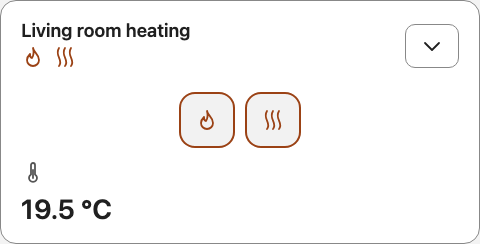

# Dashboard integration

## Standalone compact control panel

Add Flame Connect Card directly to a dashboard and select **Initial view → Compact**. Select **Compact style → Chip** to open expanded controls in a native modal when the icon or summary is pressed. The dashboard row stays compact. The standard compact style and **Chip expansion → In dashboard** retain inline expansion. This configuration requires neither Mushroom nor Browser Mod. The expanded layout is also available as the initial view for a dedicated fireplace dashboard.



The chip, modal and inline layouts use the same entity mappings, four-state artwork, image background, global visibility options and control order. Select **Controls in compact view** to keep frequently used readings or adjustments in the summary. These are a subset of the globally visible, mapped controls. Hide the target globally to omit it in both layouts.

The flame and heating indicators distinguish the two effects, including unknown state. A heating indicator means the feature is enabled; it does not prove actual heat output. Quick actions target only their corresponding entities. Pressing expand or collapse never toggles the fireplace.

Each card keeps its own expansion state. Reloading or reconfiguring returns to the selected initial view. A pending command retains its confirmation wait and timeout across layout changes. Multiple cards follow Home Assistant updates without changing one another's layout.

## Optional Mushroom summary and Browser Mod popup

Existing dashboards can keep Mushroom as a summary and host Flame Connect Card in a Browser Mod popup. These are optional dashboard dependencies, not runtime dependencies of the standalone card.

A Mushroom Climate card represents only the climate entity. To summarize a fireplace with an independent flame entity, use a Mushroom Template card that observes both, and separate quick actions. Keep whole-device power, flame and heating targets distinct. The summary's main tap can open the existing climate more-info popup while chips perform explicit actions.

For example, a summary template can follow both entity states:

```yaml
type: custom:mushroom-template-card
entity: climate.living_room_heating
entity_id:
  - climate.living_room_heating
  - light.living_room_flame
primary: Fireplace
secondary: >-
  
  
  {{ 'Heating enabled' if heat == 'heat' else 'Heating off' if heat == 'off' else 'Heating unavailable' }}
  · {{ 'Flame on' if flame == 'on' else 'Flame off' if flame == 'off' else 'Flame unavailable' }}
icon: mdi:fireplace
multiline_secondary: true
tap_action:
  action: more-info
```

Replace example IDs with actual bindings. Include the power entity if using a standby override, and distinguish Fan only from heating when that preset is active. Do not treat unavailable state as off. Summary templates should track all referenced entities. Use explicit supported actions for quick controls; do not put unsupported templates inside action data.

A Browser Mod popup can host the same expanded card configuration. Its popup target should match the summary's more-info entity. Prefer adaptive dialog behavior on narrow screens; avoid forced desktop widths, fixed heights and nested card/popup padding overrides. Retain the card's entity bindings, hidden readings and background preference. Do not silently restore hidden temperatures in the popup.

These two approaches can coexist. The built-in layout is independent of Browser Mod's installation, registration and more-info overrides. A Mushroom-based alternative retains those dependencies.

## Updates and verification

The new view options require a card release containing compact/expanded layouts. If **Initial view** is missing, confirm the installed release and reload the frontend cache. Do not expect existing installations to load unmerged source changes automatically.

After updating, check light and dark themes, keyboard focus, phone layout, independent flame/heating state, unavailable entities and pending commands. Browser tests use simulated entities; physical behavior and cloud latency depend on the backend and fireplace.
